# Cohort Manager — Current Schema Diagram

Current application data model only. The diagram describes collection relationships and does not include example or seed records.

```mermaid
erDiagram
    USERS {
        ObjectId _id PK
        string name
        string email UK
        string passwordHash
        string role
        boolean isActive
        boolean firstLoginPasswordReset
    }

    COHORTS {
        ObjectId _id PK
        string name
        string status
        string startDate
        string endDate
        string_array nominatorIds
        string trainingPlanId
        string feedbackFormId
        array talentnextCourses
    }

    MENTORS {
        ObjectId _id PK
        ObjectId_string cohortId FK
        string userId FK
        string nominatedBy FK
        string name
        string email
        string employeeId
        string department
        string location
        string timezone
        string status
    }

    TRAINEES {
        ObjectId _id PK
        ObjectId_string cohortId FK
        ObjectId_string mentorId FK
        string nominatedBy FK
        string name
        string email
        string employeeId
        string department
        string location
        string timezone
        string status
        date droppedOutAt
        string dropoutReason
    }

    TRAINING_TEMPLATES {
        ObjectId _id PK
        string name
        int totalWeeks
        array weeks
    }

    COHORT_TRAINING_PLANS {
        ObjectId _id PK
        ObjectId_string cohortId FK
        string name
        int totalWeeks
        int coreWeeks
        int bufferWeeks
        array weeks
    }

    FEEDBACK_TEMPLATES {
        ObjectId _id PK
        string name
        array fields
    }

    COHORT_FEEDBACK_FORMS {
        ObjectId _id PK
        ObjectId_string cohortId FK
        string name
        array fields
    }

    PROGRESS {
        ObjectId _id PK
        ObjectId_string cohortId FK
        ObjectId_string traineeId FK
        ObjectId_string mentorId FK
        ObjectId_string planId FK
        array items
        number percentComplete
    }

    FEEDBACK_RESPONSES {
        ObjectId _id PK
        ObjectId_string cohortId FK
        ObjectId_string traineeId FK
        ObjectId_string mentorId FK
        ObjectId_string formId FK
        int weekNumber
        object answers
    }

    TALENTNEXT_COURSES {
        ObjectId _id PK
        string name
    }

    TALENTNEXT_PROGRESS {
        ObjectId _id PK
        ObjectId_string cohortId FK
        ObjectId_string traineeId FK
        object completionMap
    }

    BATCHES {
        ObjectId _id PK
        ObjectId mentorId FK
        ObjectId cohortId FK
        string name
        string status
        ObjectId_array traineeIds
        string timezone
    }

    SESSIONS {
        ObjectId _id PK
        ObjectId batchId FK
        ObjectId mentorId FK
        date sessionDate
        string startTime
        string endTime
        string title
        string status
        array roster
        array attendance "embedded: traineeId, status, markedAt, markedBy"
    }

    USERS ||--o| MENTORS : "mentor login profile"
    USERS }o--o{ COHORTS : "nominatorIds access"
    COHORTS ||--o{ MENTORS : includes
    COHORTS ||--o{ TRAINEES : includes
    MENTORS ||--o{ TRAINEES : "assigned mentor"
    COHORTS ||--o{ COHORT_TRAINING_PLANS : configures
    COHORTS ||--o{ COHORT_FEEDBACK_FORMS : configures
    COHORTS ||--o{ BATCHES : contains
    MENTORS ||--o{ BATCHES : creates
    BATCHES }o--o{ TRAINEES : "traineeIds membership"
    BATCHES ||--o{ SESSIONS : schedules
    MENTORS ||--o{ SESSIONS : leads
    TRAINEES ||--o{ PROGRESS : tracks
    TRAINEES ||--o{ FEEDBACK_RESPONSES : receives
    TRAINEES ||--o{ TALENTNEXT_PROGRESS : tracks
    COHORTS ||--o{ TALENTNEXT_PROGRESS : scopes
```

## Notes

- Attendance is an embedded array in each session, not a separate collection in the current flow. This keeps attendance attached to the meeting where it was recorded.
- The session roster is also stored as a snapshot, so changes to a batch later do not rewrite that session's roster.
- Training plans and feedback forms are copied into cohort-specific collections when configured.
- IDs are not fully uniform across older API paths: some references use strings while others use BSON `ObjectId` values.
- A trainee is limited to one active batch at a time by application logic.
